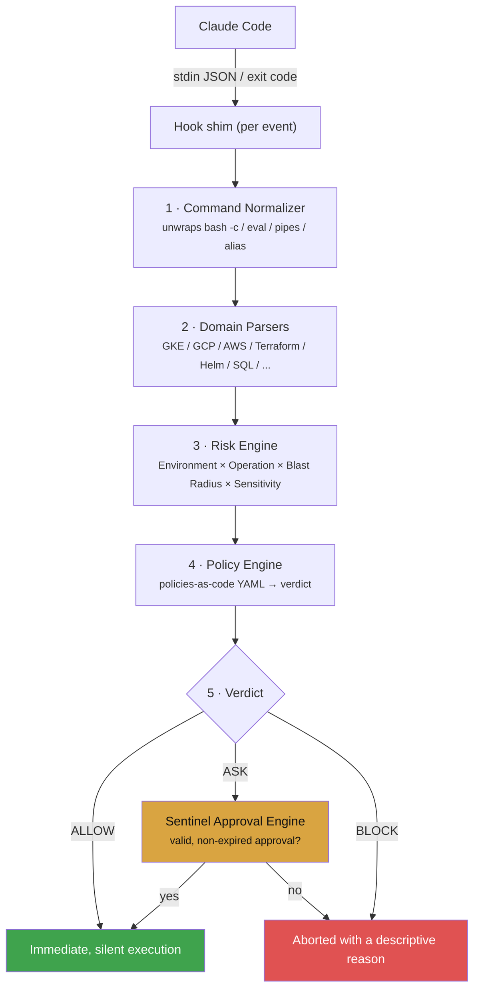

# SKX Infra Guard

<p align="center">
  
  
  
  
</p>

SKX Infra Guard is Skydropx's proprietary real-time governance, risk analysis, and policy enforcement engine designed for autonomous AI agents (such as Claude Code) operating on hybrid-cloud and production infrastructure. 

It intercepts tools and commands executed by AI agents, analyzing them inside a strict, fail-closed sandboxed pipeline to prevent destructive actions, protect sensitive data, and provide complete security compliance without human friction.

---

## Table of Contents

- [What It Does](#what-it-does)
- [Execution Lifecycle Pipeline](#execution-lifecycle-pipeline)
- [Key Features](#key-features)
- [Directory Layout](#directory-layout)
- [Getting Started](#getting-started)
  - [Prerequisites](#prerequisites)
  - [Local Setup](#local-setup)
  - [Running the Test Suite](#running-the-test-suite)
  - [Manual Command Testing](#manual-command-testing)
- [Production Deployment](#production-deployment)
- [Policy-as-Code Configuration](#policy-as-code-configuration)
- [Developer Guide: Adding New Domains](#developer-guide-adding-new-domains)
- [Documentation Suite](#documentation-suite)
- [Proprietary & Confidentiality Notice](#proprietary--confidentiality-notice)

---

## What It Does

When an AI agent requests tool execution (e.g., executing a command in the terminal or reading/writing system files), SKX Infra Guard intercepts the request and runs it through a 5-step security verification process to decide whether the command is allowed, blocked, or requires human authorization.

### Execution Lifecycle Pipeline



1. **AI Agent Tool Invocation**
   * Triggered by terminal commands, file read/write requests, or external WebFetch calls.
2. **Command Normalization (Command Normalizer)**
   * Recursively unwraps nested shell executions (`bash -c`, `sh -c`, `eval`, `xargs`, subshells, and same-line aliases).
   * Outputs a flat list of clean "effective commands" to prevent evasion techniques.
3. **Domain-Specific Parsing (Domain Parsers)**
   * Extracts targeted resources, actions, and metadata across active platforms (GKE, GCP, AWS, Terraform, Helm, Postgres, MongoDB, Redis, Git).
4. **Context & Risk Assessment (Risk Engine)**
   * Evaluates operational context against dynamic risk factors (Environment Tier × Operation Class × Blast Radius × Data Sensitivity).
   * Determines the unified risk level (from LOW to CRITICAL).
5. **Policy Intersection & Verdict (Policy Engine)**
   * Intersects the calculated risk level with versioned YAML environment policy files.
   * Outputs the final decision:
     * **ALLOW**: Immediate, silent execution.
     * **ASK**: Gated on a valid, non-expired Sentinel approval file.
     * **BLOCK**: Aborts execution and raises a descriptive block message.

---

## Key Features

* **Recursive Command Normalization:** Defeats shell-wrapping and concatenation evasion vectors.
* **Comprehensive Multi-Cloud Parsers:** Native support for GKE topology/namespaces, GCP gcloud services, AWS CLI identity security, Terraform plans, Helm chart life cycles, SQL queries, Redis key-value actions, and MongoDB shells.
* **Secrets Protection (Metadata vs. Value):** Enforces separation of boundaries between querying resource metadata (permitted) and extracting actual secret values (blocked/escalated).
* **Zero-Overhead Structured Logging:** Atomic and thread-safe audit logging using JSON Lines and kernel locks (`flock`), designed for real-time SIEM ingestion.
* **Flexible Approvals Backend:** Sentinel-based token approval store with secure signatures and time-to-live validation.

---

## Directory Layout

```
skx-infra-guard/
├── policies/                # Declarative policies-as-code YAML configurations
│   ├── global.yaml          # Global immutable constraints applied everywhere
│   ├── sandbox.yaml         # Permissive local sandbox overrides
│   ├── dev.yaml             # Development configurations
│   ├── qa.yaml              # QA automation limits
│   ├── staging.yaml         # Staging policies mirroring production
│   └── production.yaml      # Tightest security posture rules
│
├── src/skx_infra_guard/     # Core application source code
│   ├── protocol.py          # Claude Code binary communication hook protocol
│   ├── cli.py               # Dispatch routines and console entrypoint
│   ├── core/                # Engine pipelines (Normalizer, Risk, Policy, Audit)
│   ├── parsers/             # Domain lexers (Kubernetes, AWS, GCP, SQL, Redis, etc.)
│   ├── domains/             # Domain wrappers mapping actions to risk factors
│   └── approval/            # Sentinel-based approval verification channel
│
├── hooks/                   # Lightweight bash shim scripts invoked by Claude Code
├── docs/                    # Rich English architecture, threat model, and policy docs
└── tests/                   # 224 automated unit, integration, and security tests
```

---

## Getting Started

### Prerequisites
* Python 3.10 or higher
* Pip, Virtualenv

### Local Setup
Clone the repository and install the development dependencies in an isolated virtual environment:

```sh
# Set up virtual environment
python3 -m venv .venv
source .venv/bin/activate

# Install dependencies in editable mode
pip install --upgrade pip
pip install -e ".[dev]"
```

### Running the Test Suite
The project maintains a 100% offline security test suite that exercises every wrapper, normalizer, and domain parser against actual obfuscation payloads:

```sh
# Execute all 224 unit, integration, and security tests
pytest
```

### Manual Command Testing
You can dry-run any CLI command directly using the `skx-guard evaluate` subcommand:

```sh
# Test read-only command on Dev tier (should return ALLOW)
skx-guard evaluate --command "kubectl get pods -n dev" --env dev

# Test destructive command on Production tier (should return BLOCK)
skx-guard evaluate --command "kubectl delete namespace production" --env production

# Test command containing SQL comments bypass (should return BLOCK)
skx-guard evaluate --command "psql -c 'DR/**/OP TABLE users;'" --env production
```

---

## Production Deployment

To safely install SKX Infra Guard on a developer machine or CI/CD runner:

1. **Dry-Run Installation:** Preview the changes the installation script will make.
   ```sh
   bash install.sh --dry-run
   ```
2. **Execute Installation:** Installs the Python package inside `~/.claude/skx-infra-guard`, configures its isolated environment, links the hook shims under `~/.claude/hooks/`, and registers them in `~/.claude/settings.json`.
   ```sh
   bash install.sh
   ```

---

## Policy-as-Code Configuration

Environment rules are completely decoupled from code and defined as declarative structures in YAML. Here is an example of an override in `policies/global.yaml` blocking Terraform destructions universally:

```yaml
rules:
  - id: global.terraform.destroy
    domain: terraform
    match:
      operation_type: destroy
    decision: BLOCK
    reason: "Terraform destroy commands are strictly prohibited across all environments. Run changes via PR plan."
```

---

## Developer Guide: Adding New Domains

Adding a new infrastructure or service domain is clean and straightforward:

1. **Create the Parser (`src/skx_infra_guard/parsers/`):**
   Implement a parser class that parses the command and extracts metadata, mapping actions to an `OperationClass` (`READ`/`CHANGE`/`DESTRUCTIVE`/`SECURITY_CRITICAL`).
2. **Create the Domain (`src/skx_infra_guard/domains/`):**
   Add a thin domain adapter to map the parsed action and target resources into a `RiskFactors` dataclass, combine them via `RiskEngine.combine()`, and query the `PolicyEngine.evaluate()`.
3. **Register Domain in Dispatcher:**
   Link the new domain module in `src/skx_infra_guard/domains/__init__.py` and the main CLI router.
4. **Define Policies:**
   Add any immutable constraint under `policies/global.yaml` or relevant environment policies under `policies/`.
5. **Add Regression Tests:**
   Ensure robust coverage is added in `tests/unit/test_<domain>_parser.py` and potential evasion cases inside `tests/security/test_bypass_regression.py`.

---

## Documentation Suite

For deeper engagement with the engine's design, consult the following architectural records:
* **SKX Target Architecture (docs/skydropx-architecture.md)** — In-depth overview of the modules, core engines, and clean design patterns.
* **Decision & Policy Model (docs/policy-model.md)** — Formulas, blast-radius classifications, and environment-crossing constraints.
* **Security Threat Model (docs/threat-model.md)** — Analyzes mitigated vectors, security surface area, and regression criteria.

---

## Proprietary & Confidentiality Notice

> ### STRICTLY CONFIDENTIAL — INTERNAL SKYDROPX USE ONLY
>
> SKX Infra Guard is proprietary software, developed by and for Skydropx. 
>
> This repository contains private, confidential, and proprietary intellectual property of Skydropx. It is designed to enforce security policies and governance for AI agents operating on Skydropx infrastructure. 
>
> No part of this codebase may be copied, redistributed, shared externally, or published in any public form without prior written authorization from the Skydropx Legal and Security departments.
